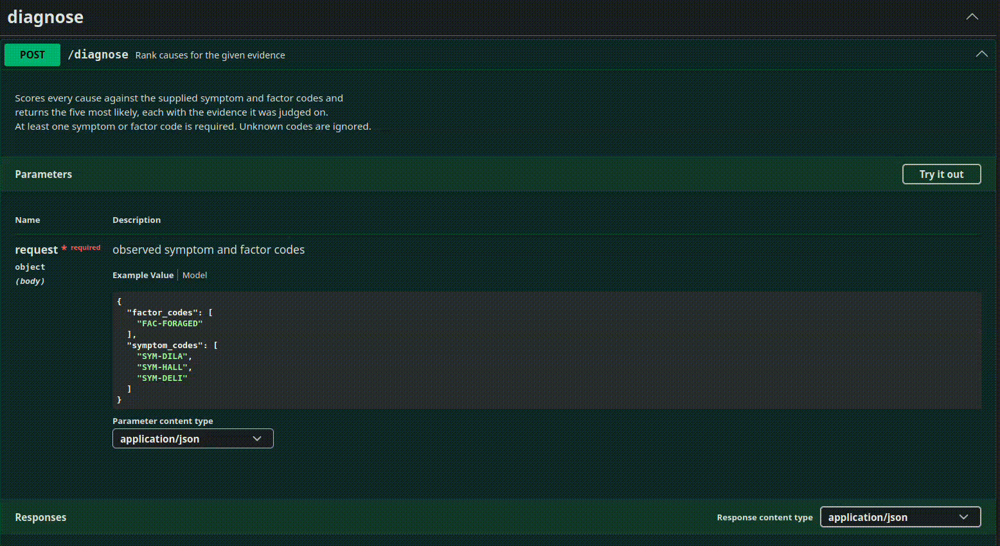
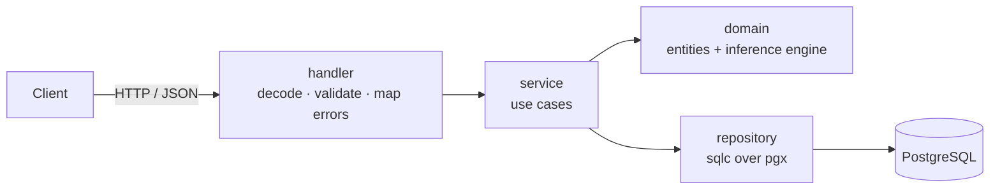

# Kusuriya 薬屋

> A diagnostic **inference engine** that ranks probable causes (poisons / diseases)
> from observed symptoms and contextual factors — and explains *why* it reached
> each conclusion. Inspired by the reasoning of Maomao in *The Apothecary Diaries*.

[](https://go.dev/)
[](./LICENSE)

Unlike a typical CRUD service, the heart of Kusuriya is an explainable naive Bayes
engine: given a set of clues, it returns a ranked list of causes with a probability
and a per-clue breakdown of *what each clue contributed* — including the clues a cause
could not account for.

---

## Demo

Ask the engine to reason about dilated pupils, hallucinations and delirium in someone
who has been eating foraged plants:





```bash
curl -X 'POST' \
  'http://localhost:8080/api/v1/diagnose' \
  -H 'accept: application/json' \
  -H 'Content-Type: application/json' \
  -d '{
  "factor_codes": ["FAC-FORAGED"],
  "symptom_codes": ["SYM-DILA", "SYM-HALL", "SYM-DELI" ]
}'
```

The response is the top five causes, best first. Each carries its `p`, the remedy, and
an `evidence` list — one entry per clue, with the weight that went into the score:

```json
[
  {
    "p": 0.5169761279640038,
    "cause": {
      "id": 8,
      "code": "POI-DATU",
      "name": "Datura (thorn-apple)",
      "type": "poison",
      "prior": 0.008,
      "description": "Delirium-inducing seeds and flowers.",
      "remedy_id": 11,
      "remedy_name": "Palace Physician's Antidote",
      "remedy_description": "A prepared counter-agent for slowed heart and clouded mind.",
      "remedy_notes": "Kept close at every banquet."
    },
    "evidence": [
      {
        "kind": "factor",
        "kind_id": 8,
        "code": "FAC-FORAGED",
        "weight": 0.7,
        "matched": true
      },
      ...
    ]
  },
  ...
]
```


> ⚠️ **This is a learning project themed after an anime. It is NOT medical software
> and must never be used for actual diagnosis.** See [Disclaimer](#disclaimer).

---

## Quick start

Requires Docker and Go 1.26. Everything comes up with one command — Postgres,
migrations, a seeded knowledge base, the API and Swagger UI:

```bash
git clone https://github.com/DenisDavidov-creator/Kusuriya.git
cd Kusuriya
make init    # first time only: installs the Go tools, creates .env, generates the OpenAPI spec
make up      # docker compose up -d --build
```

| | |
|---|---|
| API | http://localhost:8080/api/v1 |
| Swagger UI | http://localhost:8090 |
| Logs | `make logs` |
| Stop | `make down` (`docker compose down -v` to also drop the database) |

The seed (`db/init/seed.sql`) holds 29 causes from the series' storylines — lead white
face powder, aconite, fugu, mercury, datura, beriberi from polished rice — with the
symptom and factor profiles that drive the ranking.

---

## How it works

Each candidate cause `C` is scored with a **naive Bayes** model, computed in log space
so every clue contributes one additive term — which is exactly what makes the result
explainable:

```
score(C) = log P(C)
         + Σ log P(symptom_i | C)     // over observed symptoms
         + Σ log P(factor_j  | C)     // over observed factors

P(C | clues) = softmax(score)        // normalised over all causes
```

- `P(C)` — the cause's `prior`.
- `P(symptom | C)` — `likelihood` in `symptom_profiles`, one row per (cause, symptom).
- `P(factor | C)` — `modifier` in `factor_profiles`; a factor is treated as ordinary
  evidence, which keeps the math uniform with symptoms.
- A cause with **no profile** for an observed clue is not eliminated but penalised with a
  fixed weight of `0.05`. In the response that clue shows as `"matched": false,
  "weight": null`.

The top five are returned, each with its `evidence` — every term that went into the
product, so the verdict is defensible rather than a black box.

**Cases.** In an investigation, observations arrive one at a time. A case stores its
observation history; `GET /case/{id}` re-runs the same engine over everything recorded
so far, so the ranking updates as evidence accumulates (for naive Bayes this equals a
sequential Bayesian update).

The engine is two pure functions in
[`internal/domain/engine.go`](internal/domain/engine.go); the worked arithmetic for each
rule is in [`engine_test.go`](internal/domain/engine_test.go).

### Known limitations (by design)

- **Clues are assumed conditionally independent.** *Dilated pupils* and
  *hallucinations* frequently share one neurological cause, and naive Bayes double-counts
  them. Acceptable here: the goal is an explainable pipeline, not clinical accuracy, and
  the curated knowledge base keeps the effect bounded.
- **Unknown codes are silently ignored.** A typo in a symptom code just contributes
  nothing; the response does not report it.

---

## Architecture

The domain — entities and the engine — has **no dependencies** on HTTP or the
database, so the inference logic is unit-tested without any infrastructure.



```
cmd/kusuriya/          config, router, wiring
internal/
  domain/              entities + engine (pure Go)
  knowledgebase/       causes, remedies, symptoms, factors, categories, profiles
  diagnose/            one-shot ranking
  cases/               cases and observations
  httpx/               JSON helpers, error → HTTP status
  dbx/                 pg error → domain error, test-container helper
db/migrations/         golang-migrate
db/init/seed.sql       the knowledge base
docs/                  generated OpenAPI spec (not committed)
```

Each feature directory holds the same three layers — `handler → service →
repository` — talking through interfaces declared by the consumer, so every layer is
tested against a mock of the one below it.

---

## Tech stack

**Go 1.26** · `chi` (router) · `pgx` (driver) · `sqlc` (typed SQL) · `golang-migrate`
(migrations) · `log/slog` (JSON logs) · `testify` + `mockery` (unit tests) ·
`testcontainers-go` (integration tests) · `swag` + Swagger UI (API docs) ·
Docker Compose · GitHub Actions.

---

## API

Base path `/api/v1`. The full contract, with request and response examples, is in
Swagger UI at http://localhost:8090.

| Method & path | Purpose |
| --- | --- |
| `POST /diagnose` | Stateless ranking from `{symptom_codes, factor_codes}` |
| `POST /case` | Open a case |
| `GET /case/{id}` | The case plus its current ranking |
| `PATCH /case/{id}/close` | Close it |
| `POST /case/{id}/observation` | Record an observed symptom or factor |
| `GET /case/{id}/observation` | Observation history |
| `POST · GET /cause`, `GET · PUT · DELETE /cause/{id}` | Causes |
| `PUT /cause/{id}/symptom-profiles`, `…/factor-profiles` | `P(clue \| cause)` tables |
| `POST · GET /remedy`, `/symptom`, `/factor`, `/category` (+ `/{id}`) | Knowledge-base CRUD |

Errors share one envelope; `details` carries the validation problems when there are any:

```json
{ "error": { "code": 400, "message": "validation not passed",
             "details": ["code is empty", "prior out of range (0,1]"] } }
```

`400` malformed JSON, unknown field, or validation · `404` no such id · `409` duplicate
code or name · `500` anything else.

---

## Development

```bash
make test               # unit: engine, DTOs, handlers, services — no Docker
make test-integration   # + repositories against a real Postgres via testcontainers
make lint               # golangci-lint, same flags as CI
make generate           # sqlc + mockery after changing SQL or an interface
make swagger            # regenerate docs/ after changing a handler annotation
make help               # everything else
```

Integration tests start `postgres:16` in Docker, apply the migrations and truncate
between tests; they never touch your dev database. CI runs `lint` and
`test-integration` with `-race` on every push.

---

## Disclaimer

Kusuriya is a **learning project** built for a portfolio, themed after the anime/novel
*The Apothecary Diaries*. It has **nothing to do with real medicine or diagnosis** and
must never be used as such. The knowledge base is fictional and curated for
illustration only.

---

## License

MIT — see [LICENSE](LICENSE).
